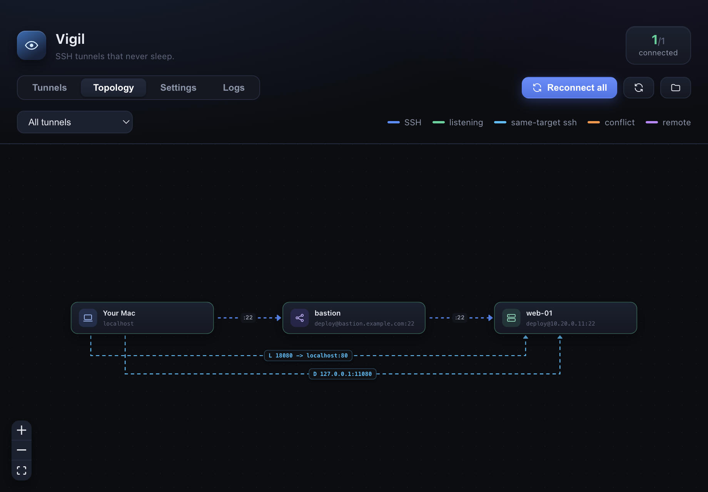
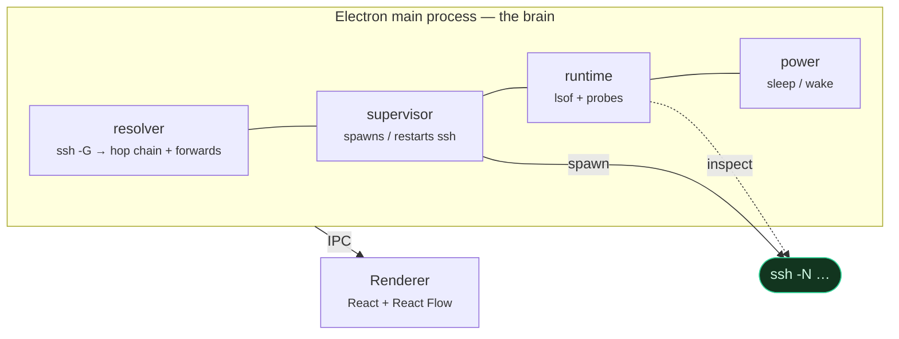
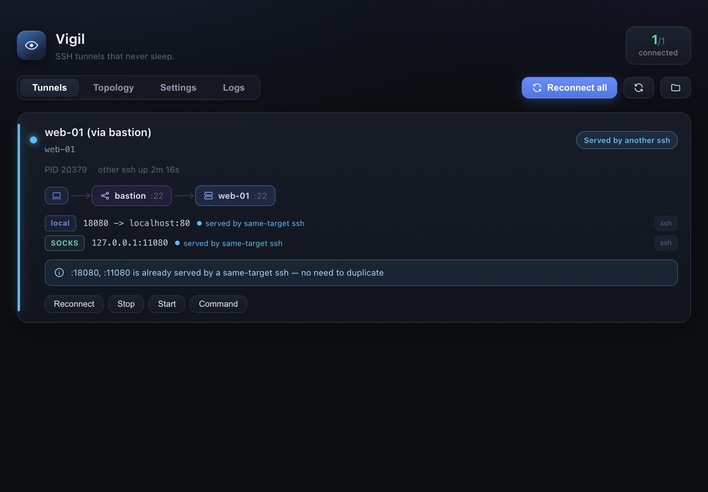
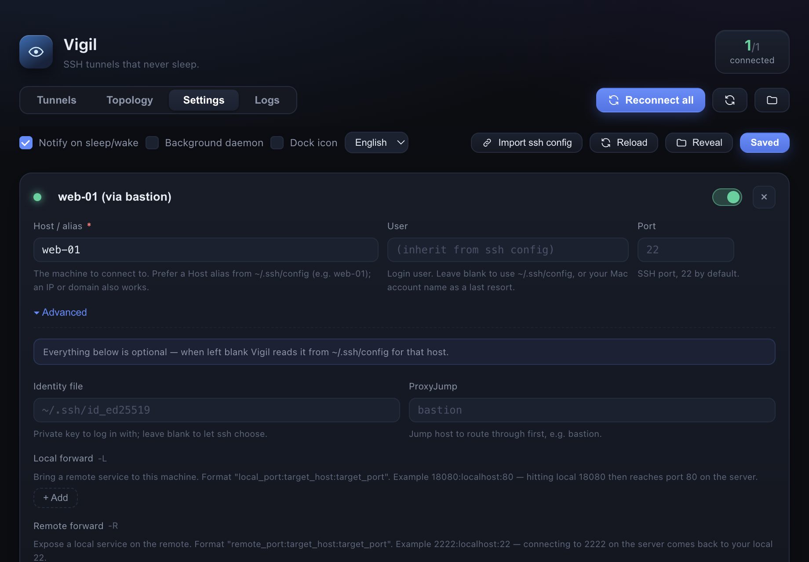
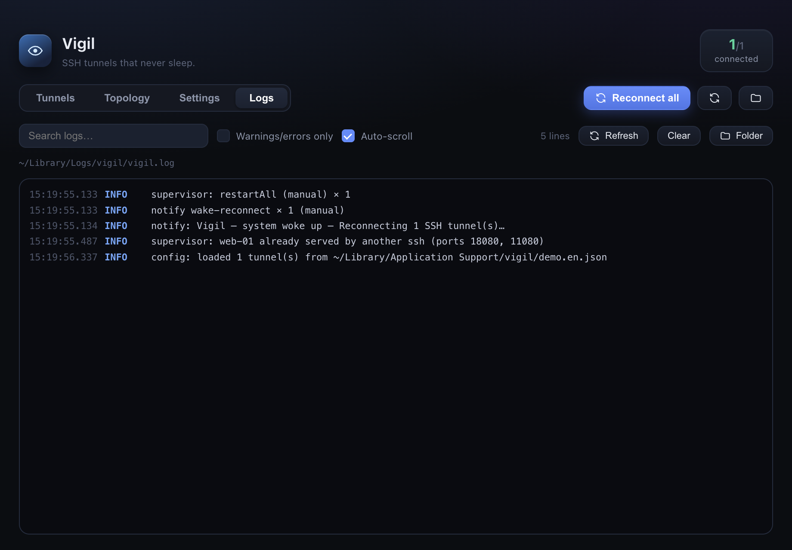
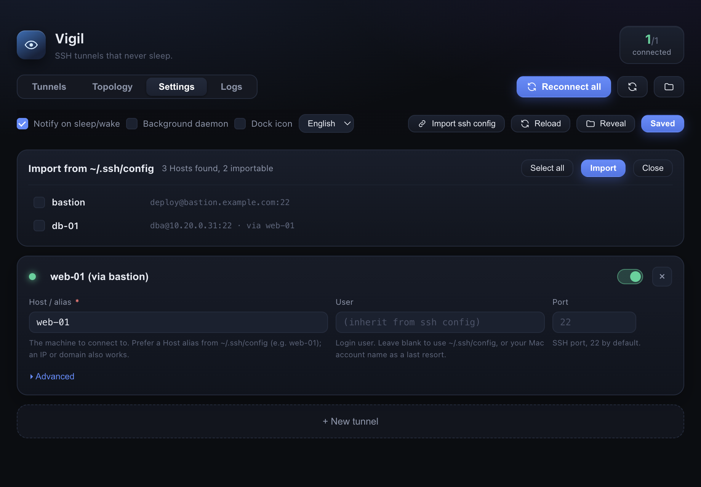

<div align="center">


<br/>
<br/>

**A macOS menu-bar guardian for your SSH tunnels.**

*Survives sleep/wake · resolves jump-host chains · skips duplicates · shows the whole topology*

<br/>

[](#requirements)
[](LICENSE)
[](https://www.electronjs.org/)
[](https://www.typescriptlang.org/)
[](#contributing)

**English** · [中文](README.zh-CN.md)

</div>

---

## Why

Laptops sleep. Tunnels die. You close the lid, come back, and your
`ssh -L 18080:localhost:80 -J bastion web-01` is a corpse — but nothing told you.
Now multiply that by a few jump hosts and a handful of port forwards and it stops
being obvious what is even connected to what.

Vigil is the thing that **keeps those tunnels alive and tells you the truth about
them**:

- It reconnects when the machine wakes, and says so.
- It expands `ProxyJump` chains and `-L/-R/-D` forwards into a real topology.
- It checks whether a forward is *actually* listening — not merely "the process exists".
- When **another ssh already serves the same forward** (hello, VS Code Remote-SSH),
  it doesn't fight it: it notices, stays quiet, and says who is handling it.

The interface ships in **English and Chinese** — switch it any time from
Settings (it follows your system locale on first run).

<p align="center">
  
</p>

## Features

<table>
<tr><td width="52%" valign="top">

**🤝 Lifecycle**

- Sleep / wake detection via `NSWorkspace` power events → fresh reconnect + native notification
- Keep-alive with exponential backoff and jitter
- Clean shutdown: no orphaned `ssh` processes, ever
- Optional **LaunchAgent**: start at login, restart on crash

**🧭 Topology**

- `ssh -G` resolution: expands `~/.ssh/config` (Host globs, `Match`, `Include`)
- **Recursive `ProxyJump`** chains collapsed into an ordered hop list
- `-L` / `-R` / `-D` parsing from both config files and your own config
- Interactive graph: laptop / relay / server icons, live edge colours

</td><td width="48%" valign="top">

**🔎 Truth on the ground**

- Runtime inspection via `lsof` across the **whole ssh process tree**
  (`ProxyJump` forks `ssh -W` children)
- End-to-end **health probe + latency** per forwarded port
- Port-conflict intelligence: same-target ssh → *already served*, different → *conflict*
- `-R` remote listener check via a throwaway `ss`/`netstat`

**⚙️ Usability**

- Bilingual UI (English / 中文), switchable in Settings
- Visual config editor with plain-language hints
- One-click **import from `~/.ssh/config`**
- Menu-bar counter + quick toggles
- In-app live log viewer
- Copy the exact equivalent `ssh` command
- Window geometry remembered, responsive layout

</td></tr>
</table>

## How it works

Vigil never reimplements SSH. It **asks SSH what it would do**, then watches what
it actually does.



1. **Resolve** — run `ssh -G <host>`. It expands every `Host` glob, `Match` block
   and `Include`, so you get the *effective* config: the jump chain, the forwards,
   the identity files. Then overlay your Vigil config (yours wins).
2. **Supervise** — spawn `ssh -N …` with keep-alive options, watch it, and restart
   with backoff. On wake, kill and reconnect immediately.
3. **Inspect** — walk the process tree, ask `lsof` which TCP sockets each pid holds,
   and probe the forwarded ports with a real TCP connect.

### Port-conflict intelligence

This is the part we're proudest of. When a forward fails to bind, Vigil finds out
**who holds the port** and compares their ssh *destination* with yours:

| The port is held by | Target | Vigil's verdict |
| --- | --- | --- |
| another `ssh` | **same host as yours** | 🟢 *already served* — don't duplicate, just tell you |
| another `ssh` | a different host | 🔴 conflict — report it, with the other destination |
| anything else | — | 🟠 conflict — report it, with the process name |

Comparing the **destination** rather than the raw command line matters, because
the port is usually declared in `~/.ssh/config` (`LocalForward …`) and never
appears on anyone's command line. That's exactly why VS Code Remote-SSH and Vigil
can share a machine without a fight.

## Screenshots

| Dashboard | Settings |
| --- | --- |
|  |  |

| Logs | Import from `~/.ssh/config` |
| --- | --- |
|  |  |

## Install

There are no prebuilt binaries yet (the app is unsigned), so build it:

```bash
git clone https://github.com/ursasi/vigil.git
cd vigil
pnpm install
pnpm build:mac            # produces dist/mac-arm64/Vigil.app
cp -R dist/mac-arm64/Vigil.app /Applications/
open /Applications/Vigil.app
```

Because the build is unsigned, macOS Gatekeeper may complain the first time. Either
right-click the app → **Open** → **Open**, or clear the quarantine flag:

```bash
xattr -dr com.apple.quarantine /Applications/Vigil.app
```

### Requirements

- macOS (Apple Silicon or Intel)
- Node.js ≥ 20.19 (≥ 22 recommended), pnpm
- The system `ssh`

> `pnpm install` could hang on the Electron binary download if you're behind a
> proxy — this repo already sets `electron_mirror` in `.npmrc`.

## Quick start

Vigil lives in the **menu bar**, not the Dock. Click the eye to open the dashboard.

1. **Settings → Import ssh config** — pick the hosts you already have and import them.
2. Edit each tunnel if needed (everything is optional and inherited from
   `~/.ssh/config` when left blank), then **Save & apply**.
3. Tick **Background daemon** to start at login and survive crashes.
4. Close the lid, open it again — you should get a notification and a fresh tunnel.

There are four tabs: **Tunnels**, **Topology**, **Settings**, **Logs**.

## Configuration

Stored at `~/Library/Application Support/vigil/config.json`
(override with `VIGIL_CONFIG`). The Settings tab edits this for you.

```jsonc
{
  "version": 1,
  "notifyOnPowerEvents": true,
  "showDockIcon": false,          // menu-bar only by default
  "tunnels": [
    {
      "id": "web-01",
      "name": "web-01 (via bastion)",
      "host": "web-01",        // an ~/.ssh/config Host alias, or an IP / domain
      "enabled": true,

      // all optional — blank means "inherit from ~/.ssh/config"
      "user": "zsh",
      "port": 22,
      "identityFile": "~/.ssh/id_ed25519",
      "proxyJump": "bastion",
      "localForwards": ["18080:localhost:80"],   // -L
      "remoteForwards": ["2222:localhost:22"],  // -R
      "dynamicForwards": ["127.0.0.1:11080"],    // -D (SOCKS)
      "sshOptions": { "ExitOnForwardFailure": "no" },
      "extraArgs": [],

      "autoReconnect": true,
      "notifyOnReconnect": true
    }
  ]
}
```

**Logs:** `~/Library/Logs/vigil/vigil.log` (also viewable in the Logs tab).

## Development

```bash
pnpm dev          # hot-reloading dev build
pnpm typecheck
pnpm build        # bundle to out/
pnpm build:mac    # icons + bundle + package
pnpm make:icons   # regenerate the app + tray icons
```

### Dev hooks

```bash
# pretend the machine just woke up, 5s after launch
VIGIL_SIMULATE_WAKE=5000 ./node_modules/.bin/electron .

# read-only self test: screenshots to /tmp, prints rendered node/edge counts
VIGIL_SELFTEST=1 ./node_modules/.bin/electron .

# also exercise save + the import panel (still does not import anything)
VIGIL_SELFTEST=1 VIGIL_SELFTEST_WRITE=1 ./node_modules/.bin/electron .

# also install + uninstall the LaunchAgent
VIGIL_SELFTEST=1 VIGIL_SELFTEST_AGENT=1 ./node_modules/.bin/electron .
```

The resolver and runtime layers are Electron-free, so you can poke at them with
plain Node:

```bash
node --experimental-strip-types scripts/resolve-check.ts
```

### Layout

```
src/
  main/      supervisor · resolver · runtime · config · power · logs · launchAgent
  preload/   contextBridge API
  renderer/  React UI (Tunnels · Topology · Settings · Logs)
  shared/    types + IPC contract
scripts/     icon / banner generators, resolver check
```

## Roadmap

- [ ] Code signing + notarization (so it can be shared without Gatekeeper pain)
- [ ] Product forwards that truly *replace* `~/.ssh/config` forwards
- [ ] Multiple profiles / config switching
- [ ] Tunnel groups

## Contributing

Issues and PRs are welcome. Please run `pnpm typecheck` before opening a PR.

## License

[MIT](LICENSE) © Shuohua Zhang

<div align="center">
<br/>
<sub>Built with Electron, TypeScript and a mildly obsessive interest in what the network is <em>actually</em> doing.</sub>
</div>
