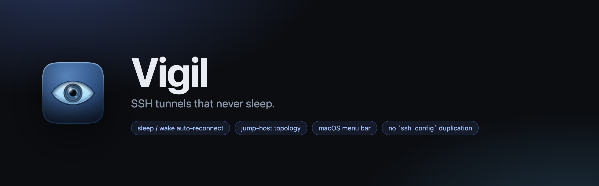
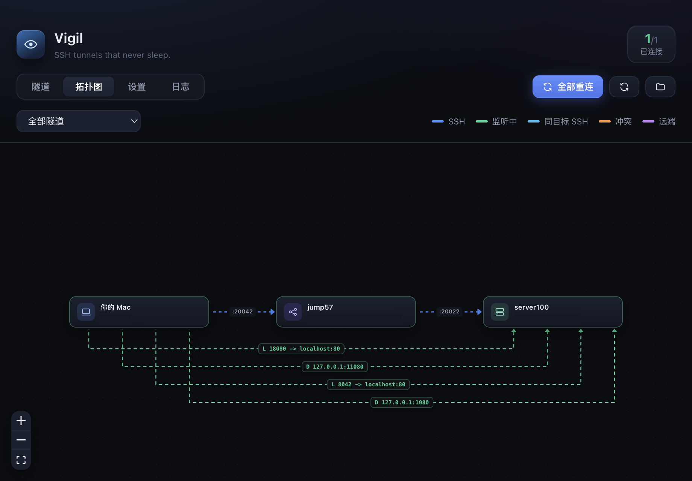
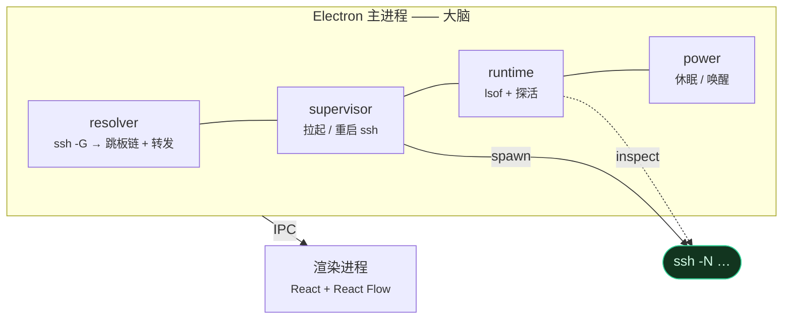
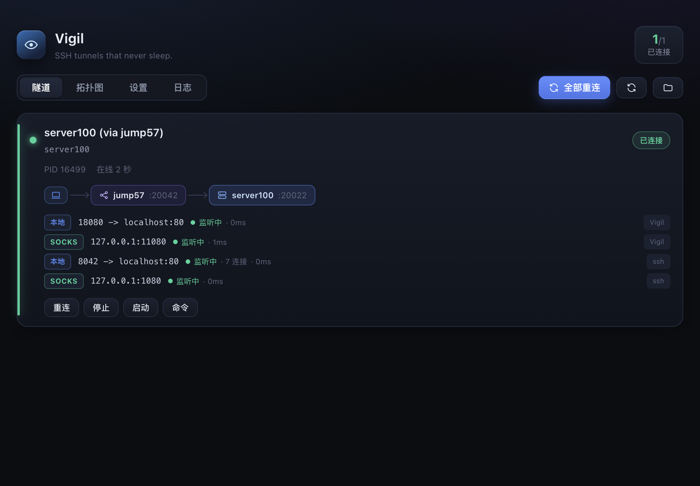
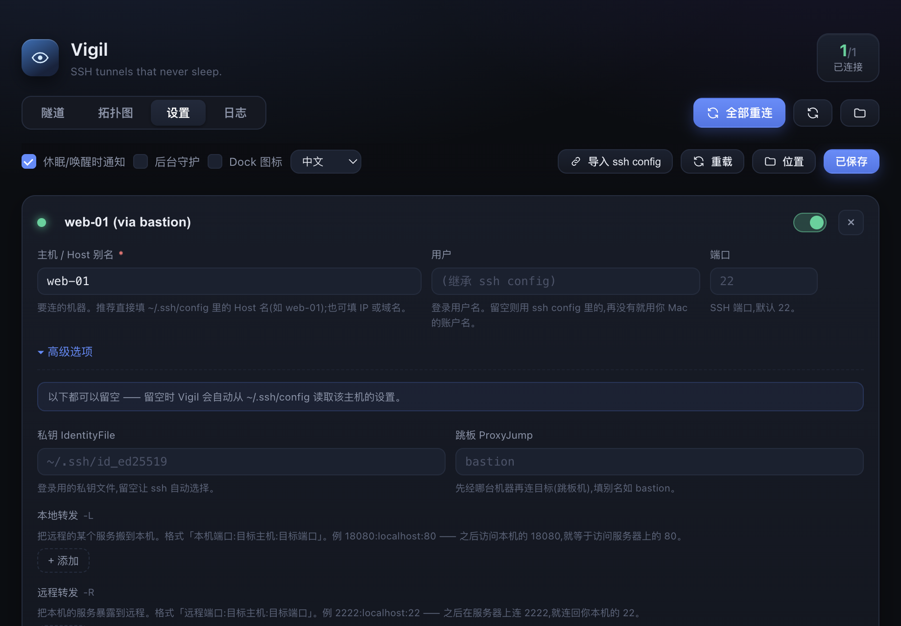
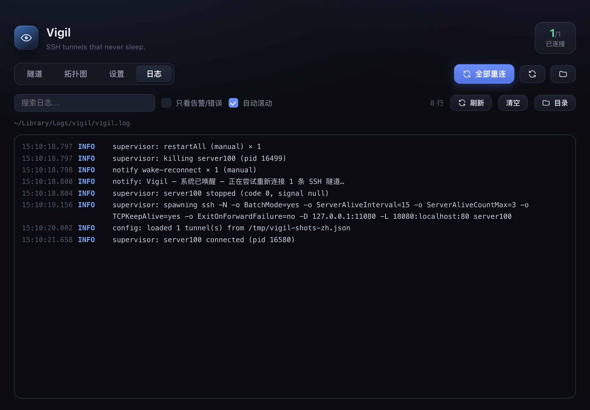
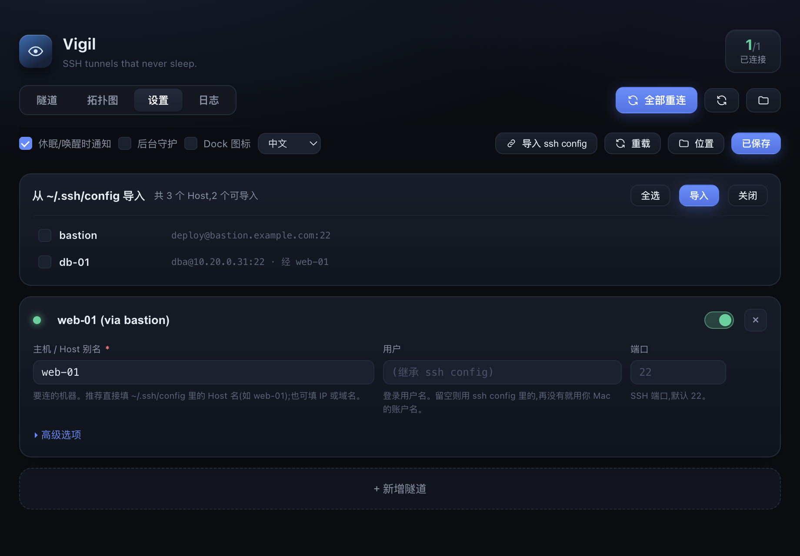

<div align="center">



<br/>
<br/>

**给 macOS 菜单栏用的 SSH 隧道守护者。**

*扛得住休眠/唤醒 · 展开跳板链 · 跳过重复连接 · 把整条链路画出来*

<br/>

[](#环境要求)
[](LICENSE)
[](https://www.electronjs.org/)
[](https://www.typescriptlang.org/)
[](#参与贡献)

[English](README.md) · **中文**

</div>

---

## 为什么做这个

笔记本会休眠,隧道会断。合上盖子再打开,你那条
`ssh -L 18080:localhost:80 -J bastion web-01` 已经死了 —— 而**没有任何东西告诉你**。
再叠加几台跳板机和一堆端口转发,"谁连着谁、转发到底通没通"就彻底变成一笔糊涂账。

Vigil 就是来**把这些隧道养着,并告诉你真相**的:

- 机器唤醒后自动重连,并且**通知你**。
- 把 `ProxyJump` 链和 `-L/-R/-D` 转发展开成一张真正的拓扑图。
- 检查转发端口是否**真的在监听** —— 而不是"进程还活着"这种假信号。
- 当**另一个 ssh 已经提供着同样的转发**(说的就是你,VS Code Remote-SSH)时,
  它不跟你抢:识别出来、不重复连、并且告诉你是谁在管。

界面支持**中文 / English 双语**,设置里随时切换(首次启动跟随系统语言)。

<p align="center">
  
</p>

## 功能

<table>
<tr><td width="52%" valign="top">

**🤝 生命周期**

- 通过 `NSWorkspace` 电源事件感知休眠/唤醒 → 重连 + 原生通知
- 保活 + 指数退避重连(带抖动)
- 干净退出:绝不留下孤儿 `ssh` 进程
- 可选 **LaunchAgent**:登录自启、崩溃自动重启

**🧭 拓扑**

- `ssh -G` 解析:展开 `~/.ssh/config`(Host 通配、`Match`、`Include`)
- **递归展开 `ProxyJump`**,得到有序的跳板链
- 同时解析配置文件与产品配置里的 `-L` / `-R` / `-D`
- 可交互拓扑图:笔记本 / 跳板 / 服务器图标,边颜色即实时状态

</td><td width="48%" valign="top">

**🔎 真实状态**

- 遍历**整个 ssh 进程树**跑 `lsof`(`ProxyJump` 会 fork `ssh -W` 子进程)
- 每个转发端口做**端到端健康检查 + 延迟**
- 端口占用智能判断:目标相同 → 已提供;目标不同 → 冲突
- `-R` 远端监听检查(用一次性 `ss`/`netstat`)

**⚙️ 好用**

- 中英双语界面,设置里随时切换
- 可视化配置编辑,每项都有人话说明
- 一键**从 `~/.ssh/config` 导入**
- 菜单栏计数 + 快捷开关
- 内嵌实时日志查看器
- 一键复制等价的 `ssh` 命令
- 记住窗口尺寸,布局自适应

</td></tr>
</table>

## 它是怎么工作的

Vigil 从不重新实现 SSH。它**先问 SSH"你打算怎么做"**,再去看**它实际做了什么**。



1. **解析** —— 跑 `ssh -G <host>`。它会把所有 `Host` 通配、`Match`、`Include` 展开,
   拿到**最终生效**的配置:跳板链、转发、私钥。再叠加你自己的 Vigil 配置(你的优先)。
2. **守护** —— 用保活参数 `ssh -N …` 拉起来,盯着它,断了按退避重连。唤醒时立刻杀掉重连。
3. **检查** —— 遍历进程树,问 `lsof` 每个 pid 占了哪些 TCP socket,再对转发端口做真实 TCP 连接探活。

### 端口占用智能判断

这是我们最得意的一块。转发端口绑不上时,Vigil 会查出**谁占着它**,并把对方的 ssh
**目标主机**和你的做对比:

| 占用者 | 目标 | Vigil 的判断 |
| --- | --- | --- |
| 另一个 `ssh` | **和你的目标相同** | 🟢 *已提供* —— 不重复连,只提示你 |
| 另一个 `ssh` | 不同主机 | 🔴 冲突 —— 报错,并显示对方目标 |
| 其他程序 | — | 🟠 冲突 —— 报错,并显示进程名 |

**为什么比"目标主机"而不是比"命令"**:端口占用往往来自 `~/.ssh/config` 里的
`LocalForward …`,命令行里根本没有那段,逐字比较必然对不上。这也正是 VS Code
Remote-SSH 和 Vigil 能在一台机器上和平共处的原因。

## 截图

| 隧道总览 | 设置 |
| --- | --- |
|  |  |

| 日志 | 从 `~/.ssh/config` 导入 |
| --- | --- |
|  |  |

## 安装

目前还没有预编译包(应用未签名),从源码构建:

```bash
git clone https://github.com/ursasi/vigil.git
cd vigil
pnpm install
pnpm build:mac            # 产出 dist/mac-arm64/Vigil.app
cp -R dist/mac-arm64/Vigil.app /Applications/
open /Applications/Vigil.app
```

因为没签名,首次打开 macOS Gatekeeper 可能拦你。右键 App → **打开** → 再点**打开**,
或者清掉隔离标记:

```bash
xattr -dr com.apple.quarantine /Applications/Vigil.app
```

### 环境要求

- macOS(Apple Silicon 或 Intel)
- Node.js ≥ 20.19(推荐 ≥ 22)、pnpm
- 系统自带 `ssh`

> 本仓库**不预设任何镜像**。如果你需要通过镜像下载 Electron 二进制,用环境变量
> 传进去即可 —— 注意 pnpm 不会把 `.npmrc` 里的 `electron_mirror` 传进 postinstall
> 脚本,所以只能走环境变量:
>
> ```sh
> ELECTRON_MIRROR=https://npmmirror.com/mirrors/electron/ pnpm install
> ```

## 快速开始

Vigil 住在**菜单栏**,不在 Dock。点那个眼睛图标打开主窗口。

1. **设置 → 导入 ssh config** —— 勾选你已有的主机,导入。
2. 需要的话改每条隧道(全部可选,留空就从 `~/.ssh/config` 继承),然后 **保存并应用**。
3. 勾上 **后台守护**,开机自启 + 崩溃自动重启。
4. 合盖、再开盖 —— 应该会收到通知,并且隧道自动重连。

共四个标签页:**隧道** / **拓扑图** / **设置** / **日志**。

## 配置

存放在 `~/Library/Application Support/vigil/config.json`(可用 `VIGIL_CONFIG` 覆盖)。
设置页可以直接改,不用手写。

```jsonc
{
  "version": 1,
  "notifyOnPowerEvents": true,
  "showDockIcon": false,          // 默认只在菜单栏
  "tunnels": [
    {
      "id": "web-01",
      "name": "web-01 (via bastion)",
      "host": "web-01",        // ~/.ssh/config 里的 Host 别名,或 IP / 域名
      "enabled": true,

      // 全部可选 —— 留空表示"从 ~/.ssh/config 继承"
      "user": "zsh",
      "port": 22,
      "identityFile": "~/.ssh/id_ed25519",
      "proxyJump": "bastion",
      "localForwards": ["18080:localhost:80"],   // -L
      "remoteForwards": ["2222:localhost:22"],  // -R
      "dynamicForwards": ["127.0.0.1:11080"],    // -D (SOCKS)
      "sshOptions": { "ExitOnForwardFailure": "no" },
      "extraArgs": [],

      "autoReconnect": true,
      "notifyOnReconnect": true
    }
  ]
}
```

**日志:** `~/Library/Logs/vigil/vigil.log`(日志标签页里也能看)。

## 开发

```bash
pnpm dev          # 热重载开发
pnpm typecheck
pnpm build        # 打包到 out/
pnpm build:mac    # 图标 + 构建 + 打包
pnpm make:icons   # 重新生成 App 与菜单栏图标
```

### 开发钩子

```bash
# 启动 5 秒后模拟一次"唤醒"
VIGIL_SIMULATE_WAKE=5000 ./node_modules/.bin/electron .

# 只读自检:截图到 /tmp,并打印渲染出的节点/边数
VIGIL_SELFTEST=1 ./node_modules/.bin/electron .

# 额外跑「保存」回环与导入面板(不会真的导入)
VIGIL_SELFTEST=1 VIGIL_SELFTEST_WRITE=1 ./node_modules/.bin/electron .

# 额外测 LaunchAgent 安装 / 卸载
VIGIL_SELFTEST=1 VIGIL_SELFTEST_AGENT=1 ./node_modules/.bin/electron .
```

解析层和运行时层不依赖 Electron,可以直接用 Node 跑:

```bash
node --experimental-strip-types scripts/resolve-check.ts
```

### 目录结构

```
src/
  main/      supervisor · resolver · runtime · config · power · logs · launchAgent
  preload/   contextBridge API
  renderer/  React 界面(隧道 · 拓扑图 · 设置 · 日志)
  shared/    类型 + IPC 契约
scripts/     图标 / banner 生成器、解析自检
```

## 路线图

- [ ] 代码签名 + 公证(分享给别人时不用再折腾 Gatekeeper)
- [ ] 产品转发**真正替换** `~/.ssh/config` 的转发
- [ ] 多套配置 / 配置切换
- [ ] 隧道分组

## 参与贡献

欢迎提 Issue 和 PR。开 PR 前请先跑一遍 `pnpm typecheck`。

## 许可证

[MIT](LICENSE) © Shuohua Zhang

<div align="center">
<br/>
<sub>用 Electron、TypeScript,以及一点点"网络到底在干嘛"的执念做成。</sub>
</div>
